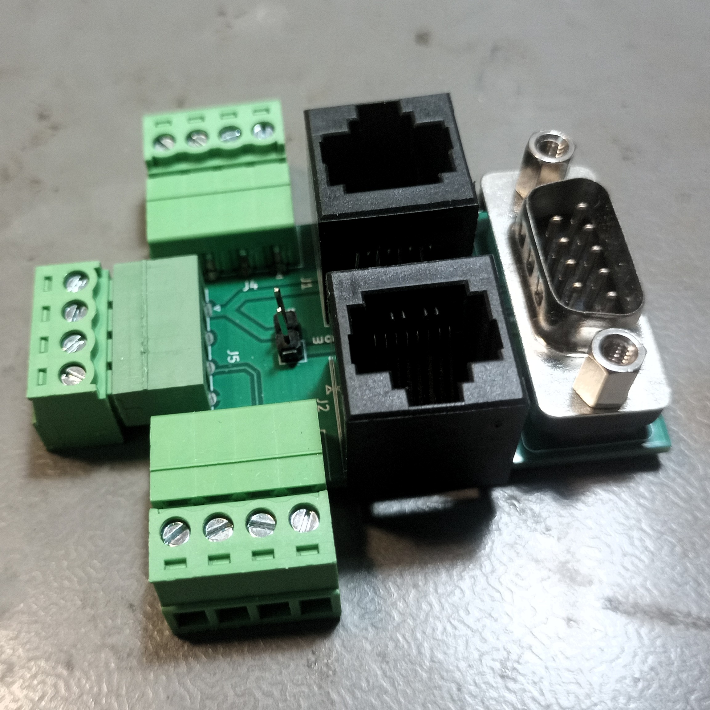
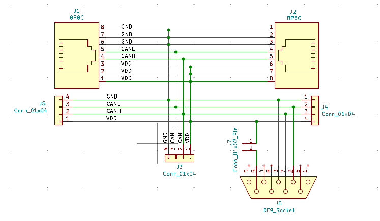
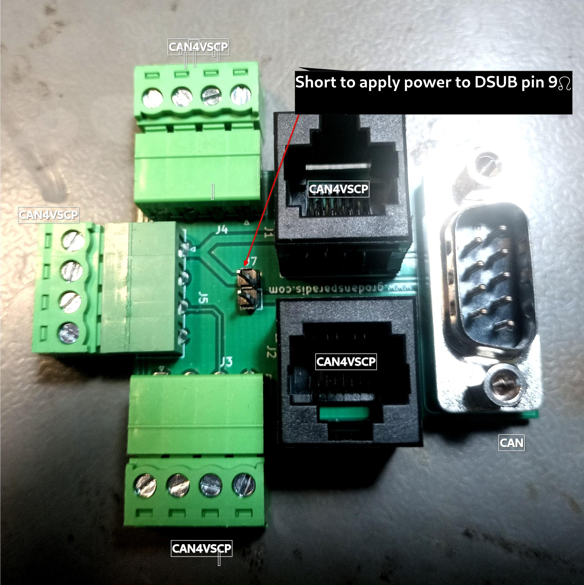

# can4vscp-trunk-adapter

A CAN4VSCP trunk adapter for connected modules and adapters on a CAN4VSCP bus. You can use it for wired trunks and and use RJ45 connectors with standard CAT cable between nodes or wired cables if you prefer. It also have a DSUB with standard CAN pinout awth pin 9 optional connected to the power line to supported adapters that take power from the bus.

The schema looks lik this

KiCAD schema and pcb is in the kicad folder. The subfolder gerbers contains the production files.